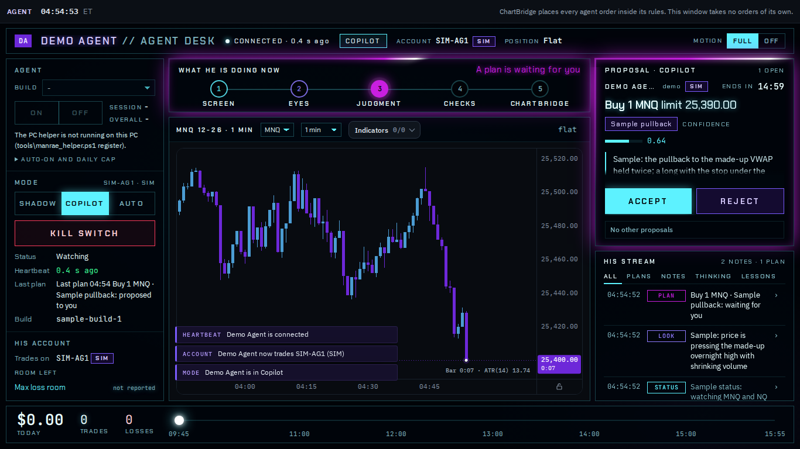
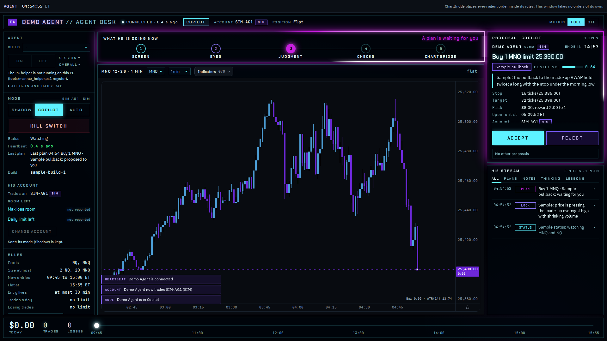

# Agent tab, board F (kit)

The Agent tab as it was before the "Layout 5 Tron" redesign (DECISION 2026-10-14a): chart 1.21.0, ChartBridge 0.5.5, main
commit `a90c3c4`, git tag `agent-tab-board-f`. Kept here so it can be opened on its own, and put back if Anthony wants it.

It is a kit, not a part of the chart page: nothing on the live page loads it and it is not in `nt8/install-files.json`, so it
never goes to a trading PC (`test/agent-kit.test.js` holds both).

| file | what it is |
|---|---|
| `agent.html` | `live/agent.html` (the pop-out page) with its paths pointed one folder up; the kit's own files beside it |
| `agent.js`, `agent-core.js`, `agent-helper.js`, `agent.css` | the tab's own files, copied |
| `agent-fonts.css` | `live/fonts/agent-fonts.css`, its font files read from `live/fonts/` |
| `board-f-1366x768.png`, `board-f-1920x1080.png` | the kit open against the fake bridge, a proposal waiting |

The page's shared parts (the chart, the PIN gate, the v3 connection, the IBM Plex and Chakra Petch font files) are the live
ones. The copies carry the parity test's `data-parity` hooks (no visual change); otherwise they are the tag's files.

## Open it against the fake bridge

```
node test/fake-bridge.mjs 8765 --v3 --trading --test-controls --test-pin=<pin> --agents=demo --agent-any-time
```

Open `http://localhost:8765/live/kits/agent-board-f/agent.html` and enter the PIN. Then give it an agent and a price (sample
data):

```
curl -X POST "http://127.0.0.1:8765/test/price?root=MNQ&p=25400"
curl -X POST "http://127.0.0.1:8765/test/agent-connect?agent=demo&name=Demo%20Agent&build=sample-build-1"
```

Change account to SIM-AG1 (on Sim101, the bot's account, demo stands down). For a proposal: Copilot, then
`curl -X POST "http://127.0.0.1:8765/test/agent-plan?agent=demo&id=k1&side=buy&kind=limit&p=25390&qty=1&stop=16&target=32&expire=900"`.

## Put it back into the real tab

From the repo root (quote the patterns, so git matches them in the tag):

```
git checkout agent-tab-board-f -- 'live/agent*.*' docs/AGENT_TAB.md 'test/agent*'
```

That restores the tab, its doc and its tests exactly as tagged. The tag is older than the parity hooks; to keep the parity test
(`npm run smoke:agent-parity`) working, take the tab's script from this kit too:

```
cp live/kits/agent-board-f/agent.js live/agent.js
```

## Screenshots

1366 x 768:



1920 x 1080:


